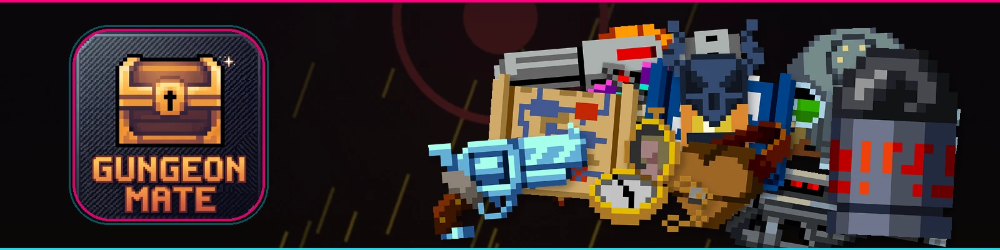
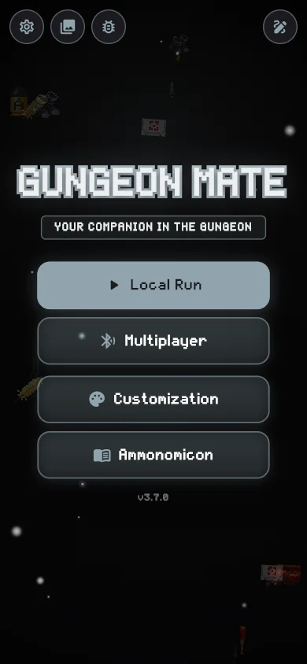
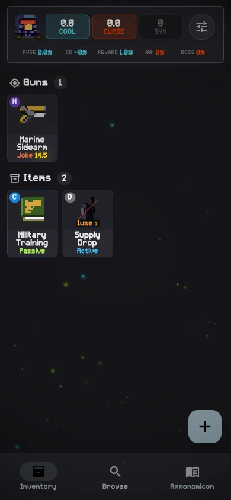
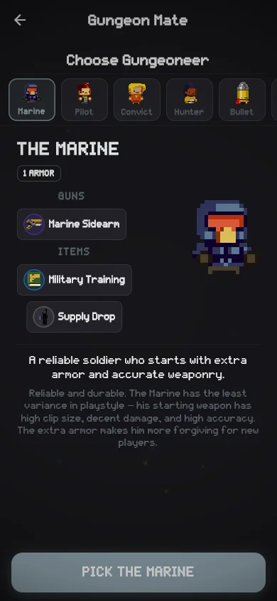
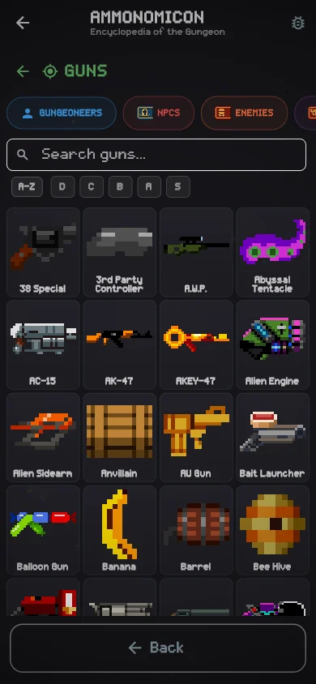
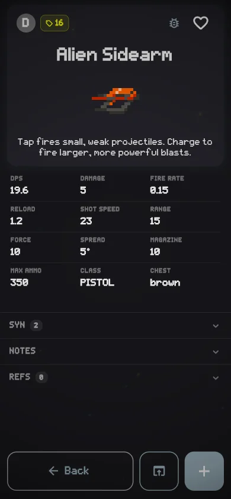
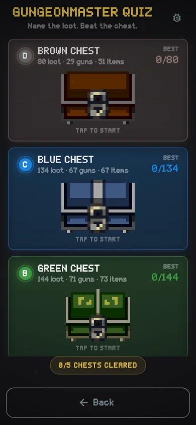
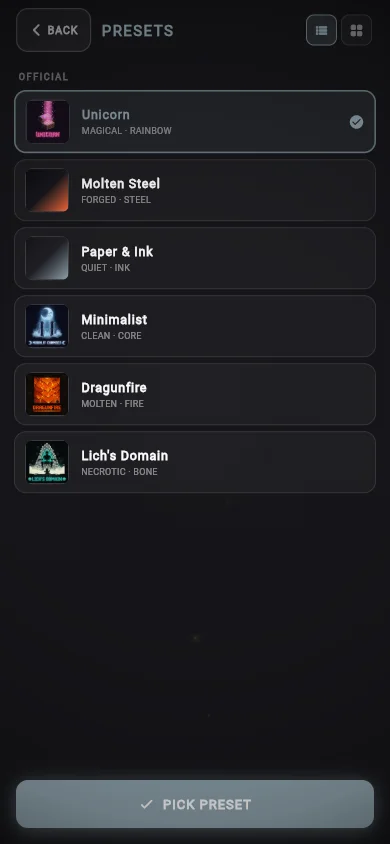
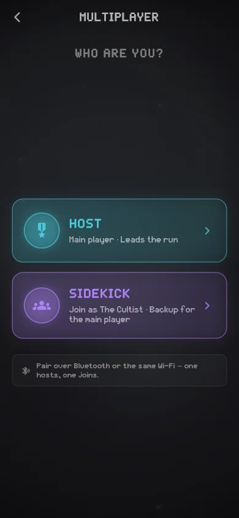

# Gungeon Mate

  

  <b>Your personal gungeon companion.</b> 
  Live run tracking, a wiki-verified codex of every gun, item and synergy, couch co-op sync, and a full theme studio — all offline, all free.

  

  
  
  
  

---

## 🧭 OVERVIEW

Gungeon Mate is an unofficial companion app for **Enter the Gungeon**. It tracks your run live — coolness, curse, shrines, synergies, DPS — while shipping the entire game database in your pocket: 239 guns, 270 items, 395 synergies and the full Ammonomicon bestiary, all verified against game data dumps and the wiki.

It started as a couch co-op companion and grew into a full companion experience: a Gungeonmaster quiz, a dice roller, deep stat tracking, and an Experience Studio with 40+ themes, 37 particle presets and 46 wallpapers — every pixel of the UI can be re-skinned live.

Everything runs **offline, on-device, free forever**. No accounts, no ads, no telemetry. Your run data never leaves your phone.

---

## ✨ FEATURES

**🏃 Run Tracking**
- Live dashboard with coolness/curse meters, shrine tracking, DPS calculator and synergy detection
- 18 special-gun dashboards (Robot, Huntress, Gunderfury, Triple Gun, Evolver, Shellegun, Chamber Gun, Platinum Bullets, Iron Coin, Spice, Metronome, Sprun, Boxing Glove, Cigarettes, Polaris, Gunther, Gun Soul, Ser Junkan…)
- Curse breakdown, effect grid, quick actions and a chronological run log

**📖 Ammonomicon Codex**
- 239 guns with full stats, DPS, quality tiers and elemental tags
- 270 items with effects, synergies and recharge times
- 395 synergies with live "would activate" detection and next-pickup hints
- Bestiary: 145 enemies, 26 bosses, objects, pickups, NPCs — plus deep codex pages (Paradox, Gunslinger, Bullet Hell, Drake, Resourceful Rat, Challenge Mode)

**👯 Co-op**
- Nearby Connections multiplayer — host or join over Bluetooth / Wi-Fi Direct
- Live snapshot sync, gift items and guns, shared loadouts, auto-reconnect, paired-device quick join
- Surprise gifts, emotes, dice rolls and side-by-side MP stats comparison
- Couch co-op with a second player loadout and item transfer

**🎨 Experience Studio**
- Preset flow — browse official + your saved presets, or build from scratch / copy an existing look
- Full editor — DETAILS / COLORS & BG / TYPE / PARTICLES / AMBIANCE / SAVE tabs with a live fullscreen mock preview
- 40+ themes including Bullet Hell, Forge Master, Robot's Core, Unicorn (multi-palette), Resourceful Rat, Lord Jammed — plus a custom color editor
- Particles — 37 presets (embers, frost shards, bullet hell, cosmic dust…), physics toggles, or float 12 real game items
- Ambiance — glow, vignette, film grain, FOG/RAIN shaders, tap sparkles, 4 background modes (gradient, solid, none, 46 wallpapers)
- Goopian language mode — English rewritten in animated alien text

**🎲 Utilities**
- Gungeonmaster Quiz — test your bullet-hell knowledge
- Gunfortuna dice game, stat sheets, Cool & Curse lab
- In-app bug reporter and 4-tab settings (Visuals, Run, App, Debug)

### Screenshots

  
  
  

  
  
  

  
  

---

## ⬇️ DOWNLOAD

  

**Android (sideload):**
1. Download `GungeonMate.apk` from the [latest release](https://github.com/Thothius/GungeonMate/releases/latest)
2. Open it on your phone — allow "install from unknown sources" if prompted
3. Play offline. No account, no Play Store, no ads.

**Windows / Linux:** build from source — `flutter build windows` / `flutter build linux` (Flutter stable required). Android builds: `flutter build apk --release`.

---

## 🛠 GETTING STARTED & REFERENCE

**Controls** — tap anything. Long-press for detail views, swipe between tabs, pull down for quick actions. Everything is touch-first and works one-handed.

**Data sources** — all game data ships in `assets/data/*.json`, verified against the [Enter the Gungeon wiki](https://enterthegungeon.wiki.gg) and game data dumps (UnityPy extraction of guns, items, synergies, enemies, shrines). Quality tiers, stats and synergy math follow game-accurate values.

**Multiplayer notes** — both players need the app; the host picks Main, the sidekick picks Join. Nearby Connections handles discovery — keep Bluetooth on. Paradox is a character pick with a blank-start inventory, not a separate mode.

**FAQ**
- *Does it need internet?* No — fully offline after install.
- *Is it affiliated with Dodge Roll / Devolver?* No — unofficial fan project.
- *Where's my run data?* On-device only (local storage + autosave).

**Links** — [Releases](https://github.com/Thothius/GungeonMate/releases) · [Issues](https://github.com/Thothius/GungeonMate/issues) · [Wiki data](https://enterthegungeon.wiki.gg)

---

## 📜 DISCLAIMER

*Unofficial fan-made companion app. "Enter the Gungeon" © Dodge Roll & Devolver Digital. All game data is sourced from public wikis and data dumps for personal reference.*

<i>Made with 💜 — free forever.</i>

